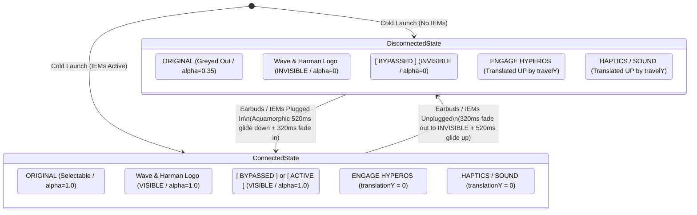

# UI Motion Design & Animation System (`ANIMATIONS.md`)

> **Project**: Buds2Pro-HyperOS-Optimizer (`Soniq DSP`)  
> **Target Display**: 120Hz AMOLED (Xiaomi Redmi Turbo 5, HyperOS / Android 16)  
> **Philosophy**: ColorOS Aquamorphic + Material Motion System (Fluid, Organic, Zero-Jank)

---

## 1. Core Philosophy: Pattern $\rightarrow$ Purpose $\rightarrow$ System

Rather than applying ad-hoc animations, all motion in this project follows the **Pattern $\rightarrow$ Purpose $\rightarrow$ Animation System** hierarchy:

```
[UI Situation / Context] 
       ↓
[Motion Pattern (Shared Axis / Container Transform / Fade Through / Spring)]
       ↓
[Interaction Purpose (Spatial continuity / Hierarchy / Physical feedback)]
       ↓
[Hardware Execution (RenderThread GPU Matrix / 120Hz VSYNC / Damped Spring)]
```

---

## 2. GitHub Reference Knowledge Base

| System / Repository | Key Patterns & Concepts | Primary Use Case |
| :--- | :--- | :--- |
| [**Material-Motion-Samples**](https://github.com/serbelga/Material-Motion-Samples) | • Container Transform<br>• Shared Axis (X, Y, Z)<br>• Fade Through<br>• Elevation Morphing | Screen-to-screen navigation, expanding cards, shared modal flows. |
| [**Android-Animation-Set**](https://github.com/OCNYang/Android-Animation-Set) | • Shared Elements<br>• Circular Reveal<br>• Vector / Path Morphing<br>• Property Animation | Complex View hierarchy transitions, canvas animations, and vector drawables. |
| [**Compose Animations Topic**](https://github.com/topics/compose-animations) | • Spring Physics (`dampingRatio`, `stiffness`)<br>• Custom Shapes & Morphing<br>• Gesture-driven interactive motion | Fluid physics-based interactions, elastic gestures, micro-interactions. |
| [**Google Android Animation Samples**](https://github.com/android/animation-samples) | • Physics-based animation (`DynamicAnimation`)<br>• Window inset animation<br>• MotionLayout & State transitions | Official Google best practices for Android 10+ hardware rendering. |

---

## 3. Motion Vocabulary & Pattern Taxonomy

### 3.1 Screen & Container Transitions

| Pattern | Purpose | When to Use | Typical Implementation |
| :--- | :--- | :--- | :--- |
| **Container Transform** | Seamlessly transforms one UI element into another (e.g., FAB to sheet, Card to detail). | Establishing direct visual persistence between a trigger and its resulting destination. | `MaterialContainerTransform` or Compose shared bounds. |
| **Shared Axis X** | Lateral spatial relationship (Forward / Backward, Next / Prev). | Paging, multi-step wizards, horizontal tab switching. | Elements slide horizontally while subtly fading ($X$ translation + alpha). |
| **Shared Axis Y** | Vertical spatial hierarchy (Upward / Downward). | Collapsing secondary panels, revealing drawers, expanding accordions. | Elements translate vertically while siblings fade in/out ($Y$ translation). |
| **Shared Axis Z** | Depth / Layering relationship (Enter deeper / Exit upward). | Opening modal sheets, entering settings from dashboard, full-screen dialogs. | Scale ($0.92 \rightarrow 1.0$) combined with elevation scrim. |
| **Fade Through** | Cross-dissolve between distinct entities that do not share physical geometry. | Switching major modes (e.g., switching from EQ visualizer to Device Settings). | Outgoing fades out ($0 \rightarrow 150\text{ms}$), incoming fades in ($150 \rightarrow 300\text{ms}$). |

### 3.2 Micro-Interactions & Button Physics

| Interaction | Visual Behavior | Easing & Timing | Haptic Feedback |
| :--- | :--- | :--- | :--- |
| **Tactile Press Down** | Compresses uniformly to `0.965f` scale. | `90ms` • `PathInterpolator(0.20f, 0.00f, 0.00f, 1.00f)` | Sharp, crisp tick (`performClick`). |
| **Tactile Release** | Smoothly rebounds back to `1.000f` without overshoot or wobble. | `220ms` • `PathInterpolator(0.20f, 1.00f, 0.30f, 1.00f)` | Mechanical release sound / subtle buzz. |
| **Slide-Out Cancel** | If finger drags outside bounds, smoothly returns to `1.000f` without firing action. | `220ms` • `PathInterpolator(0.20f, 1.00f, 0.30f, 1.00f)` | None (suppressed). |
| **Error / Denied Action** | Subtle horizontal micro-shake or soft double pulse with warning toast. | `180ms` damped oscillation. | Error double buzz (`performError`). |

---

## 4. Current Soniq DSP Motion Specification

### 4.1 Global Motion Tokens

```kotlin
// Durations
const val DURATION_TACTILE_PRESS   = 90L   // Touch compression
const val DURATION_TACTILE_RELEASE = 220L  // Spring rebound
const val DURATION_FADE_DISSOLVE   = 320L  // Secondary controls dissolve
const val DURATION_FLUID_GLIDE     = 520L  // ColorOS Aquamorphic vertical translation (~65 frames @ 120Hz)

// Interpolators
val INTERPOLATOR_TACTILE_DOWN = PathInterpolator(0.20f, 0.00f, 0.00f, 1.00f) // Sharp compression
val INTERPOLATOR_TACTILE_UP   = PathInterpolator(0.20f, 1.00f, 0.30f, 1.00f) // Critically damped rebound
val INTERPOLATOR_AQUAMORPHIC  = PathInterpolator(0.22f, 1.00f, 0.36f, 1.00f) // ColorOS fluid glide
```

### 4.2 State Transition Matrix (Earbuds Connected $\leftrightarrow$ Disconnected)



---

## 5. Architectural Invariants (Must Not Break)

1. **Zero Layout Reflow (`requestLayout` Violation)**:
   - **Never** use `ConstraintSet.applyTo(rootLayout)` with `TransitionManager.beginDelayedTransition()` when expanding or collapsing elements. It forces multi-stage layout recalculations on every frame, causing visual stutters and jarring sibling snaps.
   - **Always** use direct RenderThread GPU matrix transforms: `translationY`, `alpha`, and `scaleX`/`scaleY` on `View.INVISIBLE` backgrounds.
2. **Deterministic Startup Geometry (`doOnLayout`)**:
   - Initial layout state must wait for layout resolution (`rootLayout.doOnLayout`) before computing spatial offsets (`travelY = targetY - btnHyperOs.top`).
   - Cold startup states (`animate = false`) must be applied directly and synchronously without starting 0-duration animators.
3. **No Overshoot Wobble**:
   - Precision audio UI requires high stability and premium feel. Never use `OvershootInterpolator` on buttons; use critically damped beziers.

---

## 6. Planned Additions & Future Work

- [ ] **Spring Physics Engine**: Evaluate `SpringAnimation` (`SpringForce.DAMPING_RATIO_LOW_BOUNCY`, `SpringForce.STIFFNESS_LOW`) for dynamic gesture-driven sliders.
- [ ] **Volume / Headroom HUD Transition**: Fluid expanding pill when DSP headroom changes.
- [ ] **Morphing Vector Drawables**: Animated vector transitions between Play/Bypass/Active states.
