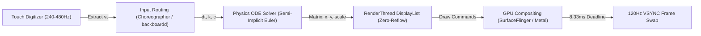
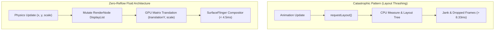

# The Physics of Fluid UI: Modern Motion Systems & Interaction Specification (`ANIMATIONS.md`)

> **Target Platform**: 120Hz High-Refresh AMOLED Displays (Xiaomi Redmi Turbo 5, HyperOS API 36 / Android 16)  
> **Ecosystem Analysis**: Apple ProMotion (iOS/macOS), Oppo/OnePlus ColorOS Quantum Animation Engine 5.0, Google Material 3 Expressive, Microsoft Windows Fluent Motion.  
> **Engineering Core**: Zero-Reflow GPU RenderNode Mutation, VSYNC Phase Offset, Damped Harmonic Oscillators.

---

## 1. Executive Summary & 120Hz Frame Budget ($8.33\text{ms}$)

Modern graphical interfaces have definitively transitioned from time-bound interpolations (tweens) to continuous, physics-based spatial orientations. Elements are computationally modeled as physical masses subjected to inertia, friction, and elastic tension. 

Transitions act as continuous mathematical functions capable of being **interrupted**, **redirected**, and **merged** seamlessly with gesture release velocity ($v_0$).

```
120Hz Frame Budget: Exactly 8.33ms per Frame
[ 1.20ms ] Input & Touch Routing (240Hz/480Hz Digitizer → Velocity v₀)
[ 1.80ms ] Physics Differential ODE Solver (Semi-Implicit Euler)
[ 2.50ms ] RenderThread DisplayList Recording (RenderNode Matrix Mutation)
[ 2.83ms ] GPU Compositing & SurfaceFlinger / Render Server VSYNC Swap
────────────────────────────────────────────────────────────────────────
Total: 8.33ms (Exceeding this causes buffer stuffing and frame drops)
```



---

## 2. Mathematical Foundations: Damped Harmonic Oscillators

### 2.1 The Governing Second-Order ODE

$$\boxed{m \frac{d^2x}{dt^2} + c \frac{dx}{dt} + kx = F_{ext}}$$

Where:
- $m$: Mass of the UI element
- $k$: Spring stiffness (restoring force constant)
- $c$: Damping coefficient (frictional drag)
- $x$: Displacement from equilibrium ($x = 0$)

The critical damping threshold is $c_c = 2\sqrt{mk}$. The dimensionless **damping ratio** ($\zeta$) dictates the perceptual feel:

$$\boxed{\zeta = \frac{c}{2\sqrt{mk}}}$$

### 2.2 Damping Regimes Matrix

| Regime | Value | Physical Behavior | Perceptual Objective & UI Context |
| :--- | :--- | :--- | :--- |
| **Underdamped** | $\zeta < 1.0$ | Mathematically overshoots target and oscillates before settling. | **Micro-interactions & Tactile Recoil**: Button presses, switches, floating action releases ($\zeta \approx 0.45 - 0.46$). Conveys stored elastic energy. |
| **Critically Damped** | $\zeta = 1.0$ | Approaches equilibrium in the fastest possible time **without overshoot**. | **Spatial Navigation**: Modal sheets, cards, full-screen transitions, shared-axis container transforms. Avoids visual disorientation. |
| **Overdamped** | $\zeta > 1.0$ | Sluggishly crawls toward equilibrium without oscillating. | **Strictly Avoided**: Creates a perceived "molasses latency effect" that degrades system responsiveness. |

### 2.3 Apple SwiftUI Physics Parameter Conversion

Apple abstracts physical mass, damping, and stiffness into `response` (seconds) and `dampingFraction` ($\zeta$):

$$\text{Response} = \frac{2\pi}{\omega_n} = 2\pi\sqrt{\frac{m}{k}}, \qquad \text{DampingFraction} = \zeta$$

---

## 3. Cross-Platform Proprietary Animation Nomenclature

A unified technical catalog mapping standard UI triggers to proprietary and industry nomenclature across Apple, Google, and ColorOS:

| UI Situation / Trigger | Industry Standard Term | Apple (iOS / macOS / SwiftUI) | Google (Material 3 / Compose) | Oppo / OnePlus (ColorOS) |
| :--- | :--- | :--- | :--- | :--- |
| **Scroll Boundary Exceeded** | Logarithmic Boundary Tension | `Rubber-Banding` / `UIScrollView.bounces` | `Stretch Over-scroll` / `EdgeEffect` | `Elastic Over-scroll` (Non-linear) |
| **App Open / Launch Icon** | Spatial Origin Zoom & Morph | `Springboard Icon Zoom` / `Interactive Pop` | `Container Transform` / `Shared Axis` | `Aquamorphic Window Zoom` |
| **Window Minimization** | 3D Mesh Vertex Shader Funneling | `Genie Effect` (WindowServer `BufferGeometry`) | N/A (Standard Desktop Scale) | N/A |
| **Button Down-Press** | Tactile Matrix Scale Recoil | `UIImpactFeedback` / `Scale Recoil` | `State Morph` / `Touch Ripple` | `Quantum Tactile Press` |
| **Button Up-Release** | Underdamped Elastic Rebound | `Interpolating Spring Rebound` | `Expressive Overshooting Spring Snap` | `Surface Tension Rebound` |
| **Gesture Swipe Handoff** | Velocity Transfer Friction ODE | `Fluid Interruptible Handoff` | `FlingBehavior` / `DecayAnimation` | `Behavioral Prediction Fling` |
| **Dynamic Pill / Island** | Sub-pixel Metaball Morphing | `Dynamic Island Morphing` | `Fluid Cloud Container Morph` | `Aquamorphic Fluid Cloud` |
| **Dock / Strip Mouse Hover** | Continuous Cosine Distance Scale | `Dock Magnification` ($\text{Scale} = 1 + \cos(d/R)$) | `Carousel Focused Expansion` | `Hover Focus Scale` |

---

## 4. Exact Numerical Parameter Tuning Matrices

| Interaction Type | Platform Framework | Exact Mathematical Parameters | Perceptual Objective |
| :--- | :--- | :--- | :--- |
| **Tactile Micro-interaction** (Button Press) | Apple SwiftUI | `response: 0.55`, `dampingFraction: 0.45` | Highly underdamped. Playful tactile bounce reflecting stored kinetic energy. |
| **Tactile Micro-interaction** (Button Press) | Material 3 Expressive | `stiffness = 380`, `damping = 18` ($\zeta \approx 0.46$), `mass = 1.0` | Overshooting spring. Creates lively tactile recoil with rapid settling. |
| **Tactile Micro-interaction** (Button Press) | Android `DynamicAnimation` | `STIFFNESS_MEDIUM (1500f)`, `DAMPING_RATIO_MEDIUM_BOUNCY (0.5f)` | Native hardware-accelerated elastic recoil. |
| **Shared Axis Translation** (Card/Panel) | Apple UIKit / SwiftUI | `dampingFraction = 1.0` (Critically Damped) | Zero oscillation. Maximizes user trust and absolute arrival without eye fatigue. |
| **Shared Axis Translation** (Card/Panel) | Material 3 Standard | Cubic-Bézier `[0.2, 0.0, 0.0, 1.0]` at `350ms` | Rapid initial acceleration fading into a long, smooth deceleration tail. |
| **Fluid Cloud / Container Morphing** | Material 3 Expressive | `stiffness = 700`, `dampingRatio = 0.6` | High-energy spatial movement. Snaps into place with microscopic, barely perceptible recoil. |
| **Fluid Cloud / Container Morphing** | Apple Dynamic Island Morph | `response = 0.3`, `dampingFraction = 0.8` | Ultra-stiff, highly damped. Softens bounding box halts without screen-tearing. |

---

## 5. Continuous Geometry: G1 Discontinuity vs G2 Squircle Curves

Standard rounded rectangles suffer from **G1 Curvature Discontinuity**: at the tangent junction where a straight edge meets a circular arc, mathematical curvature jumps abruptly from $\kappa = 0$ to $\kappa = 1/R$. The human visual cortex perceives this curvature jump as an optical kink.

Modern fluid systems enforce **G2 Curvature Continuity** via the Lamé superellipse:

$$\boxed{\left|\frac{x}{a}\right|^n + \left|\frac{y}{b}\right|^n = 1}$$

For a geometrically perfect squircle ($a = b = r, n = 4$):

$$\boxed{x^4 + y^4 = r^4}$$

```
Curvature κ(s) along Edge Traversal:
G1 Radius:      ───0───┐               ┌───0─── (Step function jump to 1/R)
                       └──────1/R──────┘
G2 Squircle:    ───0────/\___________/\────0─── (Smooth continuous bell curve)
```

> In design tools (Figma) and web CSS, setting `cornerSmoothing = 0.6` approximates the algebraic Lamé curve ($n = 4$) with zero runtime mathematical overhead.

---

## 6. Rendering Pipeline & Zero-Reflow Invariant



### Architectural Motion Rules:
1. **Never Call `requestLayout()` during Motion**: Do not mutate `LayoutParams` or use `ConstraintSet.applyTo()` with transitions for collapsing elements.
2. **Mutate RenderNode Matrices Directly**: Drive `translationY`, `translationX`, `scaleX`, `scaleY`, and `alpha` directly on hardware layers.
3. **Synchronize Initial Geometry (`doOnLayout`)**: Wait for the window hierarchy to complete its measure pass before evaluating spatial travel distances.
4. **Synchronous Cold Startup**: When initializing disconnected/collapsed states on cold launch, assign target properties directly without starting 0-duration animators.

---

## 7. Production Code Implementation Reference

### 7.1 Android: Jetpack Compose
```kotlin
import androidx.compose.animation.core.*
import androidx.compose.ui.Modifier
import androidx.compose.ui.graphics.graphicsLayer

// Material 3 Expressive: Tactile Bouncy Spring
val expressiveBouncySpec = spring<Float>(
    dampingRatio = 0.46f, // Underdamped overshoot
    stiffness = 380f      // Medium-high speed
)

// Material 3 Expressive: Spatial Navigation (Bottom Sheet / Card)
val expressiveSpatialSpec = spring<Float>(
    dampingRatio = 1.0f,  // Critically damped (zero bounce)
    stiffness = 700f      // Fast, anchored arrival
)

// Zero-Reflow Hardware Transform (Mutates RenderNode DisplayList)
val scale by animateFloatAsState(
    targetValue = if (isPressed) 0.94f else 1.0f,
    animationSpec = expressiveBouncySpec,
    label = "tactileRecoil"
)

Modifier.graphicsLayer {
    scaleX = scale
    scaleY = scale
}
```

### 7.2 Android: View System (`DynamicAnimation` & `ViewPropertyAnimator`)
```kotlin
// In Soniq DSP MainActivity.kt:
// ColorOS Aquamorphic Hardware-Accelerated 120Hz Transition
val fluidEase = PathInterpolator(0.22f, 1.00f, 0.36f, 1.00f)

btnHyperOs.animate()
    .translationY(travelY)
    .setDuration(520L)
    .setInterpolator(fluidEase)
    .start()

// Secondary Controls Soft Dissolve
visualizer.animate()
    .alpha(0f)
    .scaleX(0.96f)
    .scaleY(0.96f)
    .setDuration(320L)
    .setInterpolator(fluidEase)
    .withEndAction { visualizer.visibility = View.INVISIBLE }
    .start()
```

### 7.3 Apple SwiftUI & ProMotion
```swift
import SwiftUI
import QuartzCore

struct FluidButton: View {
    @State private var isPressed = false
    
    var body: some View {
        Text("Tactile Surface")
            .scaleEffect(isPressed ? 0.92 : 1.0)
            // response = 0.55s, dampingFraction = 0.45 creates signature Apple bounce
            .animation(.spring(response: 0.55, dampingFraction: 0.45), value: isPressed)
    }
}

// Request explicit 120Hz frame rate range on ProMotion hardware
displayLink.preferredFrameRateRange = CAFrameRateRange(minimum: 80, maximum: 120, preferred: 120)
```

### 7.4 Desktop / Web: Framer Motion & CSS Squircle
```jsx
import { motion } from "framer-motion";

const appleSpring = {
  type: "spring",
  stiffness: 400,
  damping: 28, // Matches ~0.7 damping ratio
  mass: 1
};

export const SpatialCard = ({ isExpanded }) => (
  <motion.div
    layout // Hardware-accelerated FLIP transform
    animate={{ scale: isExpanded ? 1.04 : 1.0 }}
    transition={appleSpring}
    style={{
      clipPath: "inset(0 round 24px)", // G2 Squircle simulation
      willChange: "transform"
    }}
  />
);
```
