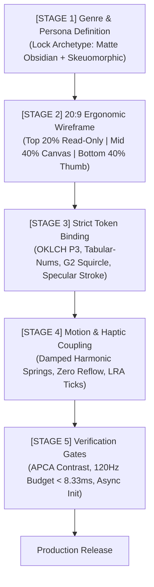

# UI Building Harness & Architectural Gate System (`UI_HARNESS.md`)

> **Mandatory Architecture Protocol**: Every new UI element, screen, modal, or redesign across the project MUST pass through this 5-stage harness before code implementation begins.

---

## 1. The 5-Stage UI Construction Pipeline



---

## 2. Detailed Pipeline Specifications

### Stage 1: Genre & Persona Definition
- **Objective**: Establish cognitive target and eliminate design drift.
- **Constraints**:
  - Persona: Audio enthusiast / power user expecting zero latency, dark-room comfort, and mechanical precision.
  - Archetype: **Matte Obsidian** (OLED `#030508`) + **Skeuomorphic-Modern** (specular tactile highlights).
  - Ambient Context: Low-light studio / mobile transit (high-contrast neon indicators on true black).

### Stage 2: Information Hierarchy & 20:9 Viewport Wireframing
- **Objective**: Satisfy Fitts's Law on tall aspect ratio displays.
- **Zonal Mapping**:
  1. **Top Zone ($0\% - 20\%$ Viewport)**: Strictly read-only passive telemetry (Codec badge, FFT visualizer, ISO 226 phon readout). Zero interactive targets.
  2. **Middle Zone ($20\% - 60\%$ Viewport)**: Secondary interaction canvas (Catmull-Rom spline wave).
  3. **Bottom Thumb Zone ($60\% - 100\%$ Viewport)**: Primary high-frequency interactive targets (`btnMasterToggle`, `btnHyperOs`, profile segmented buttons, switches).
  - **Hard Rule**: All interactive targets must measure $\ge 48 \times 48\text{dp}$.

### Stage 3: Strict Token Binding
- **Objective**: Disallow raw, untracked color hexes or arbitrary corner radii.
- **Bindings**:
  - **Color**: Defined in OKLCH with Display P3 gamut mapping. Background: `surface-000` (`#030508`). Active stroke: `neon-cyan` (`#00F0FF`). Master highlight: `satin-gold` (`#E5B869`).
  - **Typography**: Telemetry streams enforce OpenType `tabular-nums` (`tnum`) with uppercase tracking.
  - **Surface Geometry**: All rounded corners use G2 squircle continuity ($x^4 + y^4 = r^4$, `cornerSmoothing = 0.6`).
  - **Elevation**: Flat with 1px specular inner/top highlight (`oklch(100% 0 0 / 0.12)`). Muddy drop shadows are strictly prohibited.

### Stage 4: Motion System Alignment & Haptic Tactility
- **Objective**: Ensure physical affordance and zero-reflow 120Hz execution.
- **Bindings**:
  - **Kinetics**: Disallow linear tweens. Use Damped Harmonic Oscillators:
    * Interactive Press: Underdamped $\zeta \approx 0.45$, `90ms` compression down to `0.965f`.
    * Interactive Release: Damped rebound $\zeta \approx 1.0$, `220ms` rebound back to `1.0f`.
    * Layout Translations: ColorOS Aquamorphic `520ms` with `PathInterpolator(0.22, 1.0, 0.36, 1.0)`.
  - **Haptic Coupling**: Discrete detents bind to `performClick()` / `HapticFeedbackConstants.CLOCK_TICK`. Errors bind to `performError()`.
  - **Render Pipeline**: Direct GPU RenderNode matrix mutation (`translationY`, `alpha`, `scale`). Never call `requestLayout()`.

### Stage 5: Verification Checklist & Quality Gates
- **[ ] Gate 1: APCA Contrast Safety**: All telemetry and text must achieve $\ge L_c 60$ against OLED black background.
- **[ ] Gate 2: 120Hz Frame Budget**: Frame render times strictly $< 8.33\text{ms}$ on RenderThread; tabular numerals active on all changing numbers.
- **[ ] Gate 3: Cold Startup Asynchrony**: Shaders and audio engines initialize asynchronously; cold disconnected state renders synchronously with zero flash.
- **[ ] Gate 4: Gamut Fallback**: P3 neon colors map gracefully to sRGB via Oklab raytracing without hue drifting on standard screens.

---

## 3. UI Harness Deployment Schema (JSON)

```json
{
  "$schema": "https://json-schema.org/draft/2020-12/schema",
  "title": "SoniqDSP_UI_Harness",
  "type": "object",
  "properties": {
    "genre": { "type": "string", "const": "Professional Audiophile Utility" },
    "aesthetic": { "type": "string", "const": "Matte Obsidian + Skeuomorphic Hybrid" },
    "geometry": {
      "aspect_ratio": "20:9",
      "corner_shape": "squircle",
      "squircle_exponent": 4,
      "min_touch_target_dp": 48,
      "top_passive_zone_pct": 20,
      "bottom_thumb_zone_pct": 40
    },
    "tokens": {
      "surface_base": "oklch(0% 0 0)",
      "surface_card": "oklch(18% 0.01 260)",
      "accent_active": "oklch(70% 0.30 210)",
      "accent_master": "oklch(80% 0.20 85)",
      "specular_stroke": "1px oklch(100% 0 0 / 0.12)",
      "font_features": "tabular-nums"
    },
    "motion": {
      "frame_budget_ms": 8.33,
      "button_down_duration_ms": 90,
      "button_up_duration_ms": 220,
      "layout_glide_duration_ms": 520,
      "glide_interpolator": "cubic-bezier(0.22, 1.0, 0.36, 1.0)"
    }
  }
}
```

